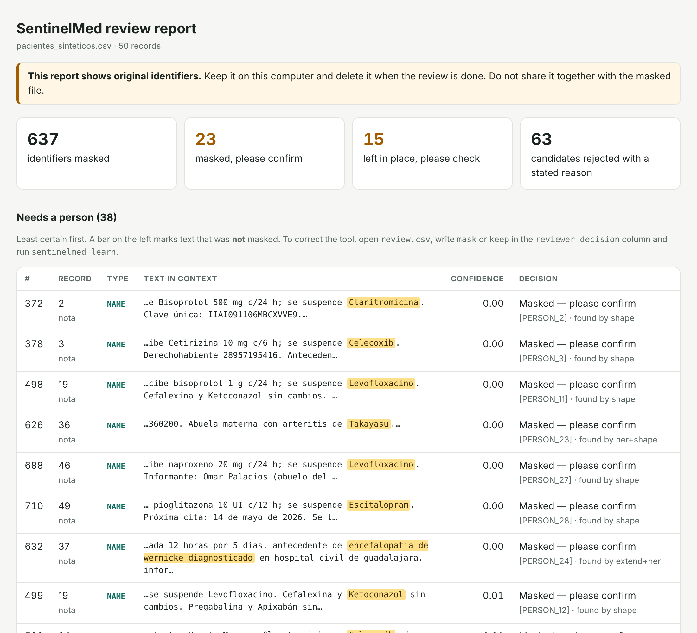

# SentinelMed

**AI protection for patient data.** SentinelMed finds and masks patient identifiers (names, CURP, NSS, RFC, phones, addresses, birth dates) in Mexican clinical tables and notes, entirely on your own computer, and shows a person only the cases it is unsure about.

**Why it exists.** Clinical records in Mexico hold Mexican-specific identifiers that general de-identification tools do not know, and hospitals cannot send them to a cloud service to be cleaned. A tool that runs locally and explains its doubts could let health data be shared for research without exposing patients.

**Status: proof of concept, built and tested on synthetic records only. Do not use it on real patient data.** On text like its training data it protects 99.9% of identifiers. On text written in ways it had never seen, it protected 87–90%, and four records in ten still had at least one identifier left. The evaluation section reports both numbers.

Created by Roberto Sanchez Valenzuela, computer science engineering student at CETYS Universidad (Mexicali), as a project selected for Seeds for the Future México 2026.



## Try it!

```bash
pip install -e ".[ner,excel,dev]"
python -m spacy download es_core_news_sm     # optional language-model layer

sentinelmed demo --out demo --hard           # 50 invented patient records
sentinelmed mask demo/pacientes_sinteticos.csv --out demo/salida
```

Open `demo/salida/review.html`. The output folder holds:

| File | What it is |
|---|---|
| `pacientes_sinteticos.masked.csv` | The table with identifiers replaced by placeholders. This is the file to share. |
| `review.html`, `review.csv` | Every finding with its confidence. **Contains original identifiers. Keep it local.** |
| `findings.jsonl` | Features of each finding, used when the tool learns from a reviewer. |
| `key.csv` | Placeholder → original value. Written only with `--save-key`. This is the re-identification key. |

The trained classifier in `models/` was saved with scikit-learn 1.9. If it does not load on your version, run `sentinelmed train` (about a minute).

It also takes `.xlsx` and plain `.txt` notes. Nothing leaves the computer: there are no network calls.

```
Paciente Itzel Xicoténcatl Pech, femenino de 34 años, acude con su mamá Rosa Pech por dolor abdominal.
Vive en Av. Reforma 1450 Int. 3, Col. Nueva, Mexicali, B.C. Cel. 686 555 0142. CURP XIPI920314MBCCCT05.
Se inicia omeprazol 20 mg cada 24 horas. Signo de Murphy negativo. Folio de laboratorio 2026110455.

Paciente [PATIENT_1], femenino de 34 años, acude con su mamá [RELATIVE_1] por dolor abdominal.
Vive en [ADDRESS_1] Cel. [PHONE_1]. CURP [CURP_1].
Se inicia omeprazol 20 mg cada 24 horas. Signo de Murphy negativo. Folio de laboratorio 2026110455.
```

## How it works

**1. Detect** (`rules.py`). Regular expressions for identifiers with a fixed format: CURP, NSS, RFC, phone, e-mail, birth date. The CURP and NSS check digits are verified.

**2. Understand** (`language.py`). Names, family members and addresses in free text, from four kinds of evidence:

- words that announce a name (`paciente`, `Dra.`, `su esposa`, `Contacto:`) and verbs only people do (`Itzel refiere…`)
- a list of about 950 Mexican first names and surnames
- shape: a capital letter in mid-sentence, or a run of ALL-CAPS words
- a Spanish spaCy model, if installed
- in a table, the patient's name from the name column is searched for in that row's note

**3. Protect** (`pipeline.py`). Each identifier becomes a consistent placeholder. `Juan Pérez López`, `Sr. Pérez` and the name column of the same row all become `[PATIENT_1]`. The same phone or birth date written two ways gets one placeholder. Relatives and doctors get `[RELATIVE_n]` and `[DOCTOR_n]`.

**The second reviewer** (`classifier.py`). A logistic regression scores every candidate from how it was found, what it looks like and the words around it. It never sees the identifier itself. It can only leave a candidate unmasked when it has a concrete reason:

| Score | Reason to reject? | Decision |
|---|---|---|
| ≥ 0.90 | | masked |
| 0.20 – 0.90 | | masked, flagged for a person |
| < 0.20 | no | masked, flagged for a person |
| 0.02 – 0.20 | yes | left in place, flagged for a person |
| < 0.02 | yes | left in place |

Reasons are things like "followed by a dose", "disease named after a person", "number follows a paperwork word". The rule exists because the first blind test showed the classifier rejecting about four real names in ten on unfamiliar text.

**Learning from reviewers.** In `review.csv`, write `mask` or `keep` in the `reviewer_decision` column, then run:

```bash
sentinelmed learn demo/salida/review.csv
```

The decisions are stored as features (neighbouring words, word endings), not as identifiers, and count ten times as much as a synthetic example when the classifier is retrained. For an identifier the tool missed entirely, add it to a text file and pass `--denylist`.

## Evaluation

Each test set has 1,000 synthetic notes of 4–10 sentences. A fifth are in ALL CAPS or all lowercase and a quarter have no accents.

- **Recall**: an identifier counts as protected only if every letter and digit of it is masked.
- **Precision**: a masked span counts as correct if at least half of it is a real identifier.

| Test set | What is new to the tool | Role |
|---|---|---|
| Standard | Nothing. Same names and sentence patterns as training. | Sanity check |
| Hard | Names, medicines and sentence patterns not used in training. | Development: I studied its errors |
| Blind | A second set of new names and patterns. | Scored blind once, then used for development |
| **Final** | A third set, written after development stopped. | **Scored once. The number to trust.** |

Recall / precision as each layer is added:

| Layers | Standard | Hard | Blind | **Final** |
|---|---|---|---|---|
| 1. Rules only | 0.491 / 0.887 | 0.448 / 0.800 | 0.393 / 0.811 | **0.337 / 0.782** |
| 2. + context and name list | 0.999 / 0.875 | 0.999 / 0.751 | 0.975 / 0.817 | **0.865 / 0.805** |
| 3. + spaCy language model | 0.999 / 0.857 | 0.999 / 0.736 | 0.976 / 0.788 | **0.878 / 0.756** |
| 4. + confirmation classifier | 0.999 / 0.986 | 0.999 / 0.909 | 0.974 / 0.922 | **0.868 / 0.863** |
| 5. + patient name from the table | 0.999 / 0.986 | 0.999 / 0.909 | 0.985 / 0.923 | **0.897 / 0.866** |
| Records with any identifier left (row 5) | 0.6% | 0.3% | 6.6% | **40.0%** |
| Findings sent to a person (row 5) | 1.3% | 12.1% | 26.8% | **26.7%** |

What the table says:

- **The gap between columns is the main result.** The same code scores 0.999 on text like its training data and 0.87–0.90 on text that is not. Scores on a set you have studied measure memory.
- **Rules alone protect a third to a half of identifiers.** Names and addresses are most of the problem.
- **The classifier does its job on over-tagging**: on the final set precision goes from 0.756 to 0.863 at a cost of one point of recall.
- **The small spaCy model adds little** (about one point of recall) and lowers precision. It is trained on news, not clinical notes.

Final set by identifier type (row 4, notes alone):

| Type | In the notes | Recall | Precision |
|---|---|---|---|
| CURP, RFC, e-mail | 723 | 1.000 | 1.000 |
| NSS | 303 | 1.000 | 0.585 |
| Phone | 461 | 1.000 | 0.666 |
| Name | 2,508 | 0.917 (0.974 with the table) | 0.892 |
| Address | 576 | 0.536 | 1.000 |
| Birth date | 341 | 0.496 | 1.000 |

What went wrong on the final set:

- **Birth dates**: half were written `FN 22/02/1944`. The rule knew `F.N.` and `Fecha nac.` but not `FN`.
- **Addresses**: `Vive por Cuitláhuac # 270` (no street word), `C. Uxmal # 663` and `Blvr.` (abbreviations not in the list).
- **Names**: a first name it does not know opening a sentence (`Teodora, de 46 años, vino…`), and unknown names in ALL-CAPS or lowercase notes with nothing announcing them (`HABLAR CON KALEB SI NO CONTESTA`). Without capitals and without a list hit there is nothing for rules to hold on to.
- **Numbers**: `Estudio número 82294649174; recibo 2024930061` were masked as NSS and phone. This is over-tagging, the safe direction.

The first blind score, before the second round of work, was worse: recall 0.832 before the classifier and 0.630 after it. The classifier had learned "no announcing word, so not a name", which is true of synthetic training text and false of real writing. Two changes fixed that: training variants with the neighbouring words and list hits removed, and the "no reason, no rejection" rule.

**After the final score was recorded**, I fixed the gaps it exposed that were one-line fixes (`FN`, `vive por`, `C.`/`Blvr.`/`Avda.`, `recibo`), added the dose pattern as a reason to keep a medicine name, and gave the same birth date one placeholder across formats. The final set has not been re-scored and should not be: it would now be a development set. On the three development sets the current code scores 0.999 / 0.991, 0.999 / 0.925 and 0.974 / 0.922 (row 4).

Reproduce with `sentinelmed train` and `sentinelmed evaluate`. `models/evaluation_frozen.json` holds the numbers in the table. `sentinelmed evaluate --final` re-scores the final set with the current code, which is a different measurement.

## Limits

- **Synthetic text is far more regular than real notes.** Real notes have typos, shorthand, mixed languages and layouts nobody planned for. Expect real recall below the final-set figure until it is measured on real, annotated notes.
- **The name list has about 950 entries.** Indigenous surnames, new given names and foreign names are the ones it misses, and those patients are not a random subset.
- **Notes without capitals are the weak spot.** Unknown names there are found only when a known word announces them.
- **Not masked by design**: visit dates, ages, city names on their own, institution names, the doctor's cédula. Mexican rules and research needs differ on these, so decide per project.
- **Same full name, same placeholder.** Two different patients called the same thing share one `[PATIENT_n]` unless they are in different tables.
- **Over-tagging**: medicine brand names and eponyms outside the lists are masked and flagged (`Buscapina`, `esófago de Barrett`).
- Masking identifiers is one part of de-identification. Rare diagnoses, small towns and exact dates can still point to a person. This tool does not assess that risk and does not make a dataset legally anonymous.

## Next steps

1. **Measure on annotated clinical Spanish.** [MEDDOCAN](https://temu.bsc.es/meddocan) is a public corpus of Spanish clinical cases annotated for protected health information. Its formats are from Spain, so it tests names and free text, not CURP or NSS.
2. **Replace the small spaCy model** with a Spanish clinical NER model fine-tuned for de-identification (PyTorch or MindSpore). This is where the missing recall on names is.
3. **A safe-word list for notes without capitals**: mask any word that is not known Spanish or clinical vocabulary, instead of looking for words that are known names.
4. **Bigger lists**: a national name-frequency list, the Cuadro Básico of medicines, SEPOMEX colonias and postal codes.
5. **A pilot with reviewers**, on real notes inside a clinic, to see how long review takes at a 27% flag rate and whether corrections bring it down.
6. A calibrated classifier (the scores are near 0 or 1 on synthetic data) and a small web interface.

## Layout

```
LICENSE  README.md  pyproject.toml
docs/review-report.png
sentinelmed/
  rules.py       step 1: regular expressions and check digits
  language.py    step 2: names, family references, addresses; optional spaCy
  classifier.py  features, the confirmation model, reasons for rejection
  pipeline.py    step 3: placeholders; tables and single texts
  report.py      review.csv and review.html
  synth.py       synthetic records with gold labels, and the four test sets
  training.py    training, evaluation, learning from reviewers
  lexicons.py    word lists      data/  larger name lists
  cli.py
models/confirm.joblib        trained on 4,000 synthetic records
tests/                       34 tests: pytest
```

## Credits and licences

- The larger name lists come from the [Faker](https://github.com/joke2k/faker) project (MIT). See `sentinelmed/data/NOTICE.txt`.
- The optional spaCy model `es_core_news_sm` is distributed under GPL 3.0. SentinelMed runs without it (`--no-ner`); check that licence before redistributing a bundle that includes the model.
- pandas, scikit-learn, spaCy.
- SentinelMed itself is MIT licensed (`LICENSE`).
